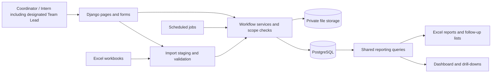
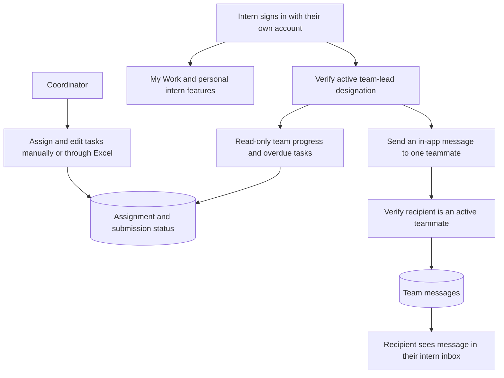
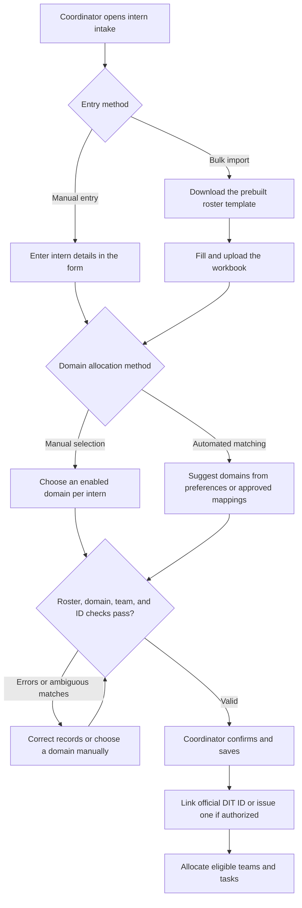
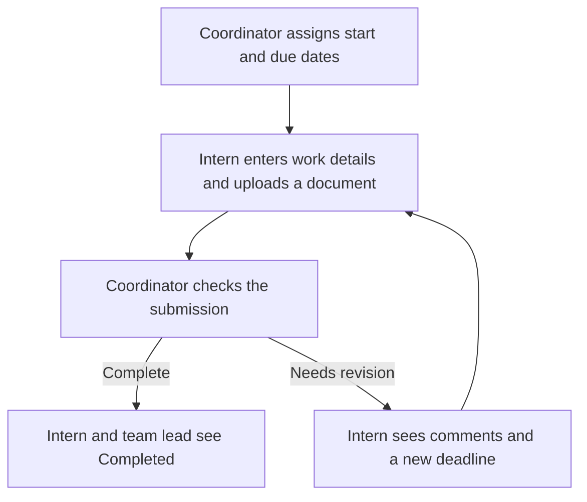

# Internship Task Tracking and Submission Review

## 1. Architecture

Build a new Python web application with three connected workflows across internship operations, attendance, and submission review. Use the old Flask application as a reference for fields, reports, and migration mapping. Build a fresh application and interface in the new workspace.

| Layer | Proposed choice | Responsibility |
|---|---|---|
| Web application | Django with server-rendered templates | Role-specific pages, forms, sessions, permissions, and validation |
| Interface | Bootstrap, project CSS, and Chart.js | Responsive layouts, accessible forms, tables, and dashboard charts |
| Records | PostgreSQL in development and production | Interns, cohort memberships, assignments, attendance, submission reviews, and audit history |
| Excel | `openpyxl` | Read approved `.xlsx` templates, validate rows, and generate formatted workbooks |
| Files | Private storage | Submission artifacts, staged workbooks, and authorized downloads |
| Scheduled work | Django management commands run by the host scheduler | Prepare reminders and follow-up lists, record job runs, and retry safely |



PostgreSQL holds the approved records. Excel is used for intake, offline entry, and export. A manual form and its equivalent bulk import call the same workflow service. Use Django's authentication and groups for role capabilities, with explicit application checks for the user's intern, cohort, and team scope. Use database transactions for approvals and bulk commits. Use bounded workbook sizes and streaming workbook reads where appropriate. [Django authentication](https://docs.djangoproject.com/en/5.2/topics/auth/default/) · [Django transactions](https://docs.djangoproject.com/en/5.2/topics/db/transactions/) · [openpyxl optimized modes](https://openpyxl.readthedocs.io/en/stable/optimized.html)

## 2. Project structure and modules

```text
internship-operations/
├── manage.py
├── pyproject.toml
├── .env.example
├── README.md
├── config/                  Settings, URL routing, application entry point
├── apps/
│   ├── accounts/            Invites, verified accounts, roles, resource scopes
│   ├── interns/             Intern master, DIT ID validation and issuance
│   ├── domains/             Domain catalogue, preferences, and allocation rules
│   ├── teams/               Cohorts, teams, team leads, membership history
│   ├── messaging/           Scoped team-lead messages and intern inbox
│   ├── tasks/               Task register, individual assignments, deadlines
│   ├── submissions/         Intern uploads, attachments, and revision history
│   ├── attendance/          Sessions, attendance entries, and corrections
│   ├── reviews/             Submission verification, decisions, and coordinator comments
│   ├── imports/             Prebuilt Excel templates, staging, row errors, commit history
│   ├── reporting/           Shared metrics, dashboards, drill-downs, Excel exports
│   └── operations/          Audit events, scheduled follow-ups, and legacy import
├── templates/              Shared layouts, page templates, and reusable components
├── static/                 Design tokens, CSS, JavaScript, and charts
├── tests/                  Workflow tests, workbook fixtures, and reconciliation
└── docs/                   User guide, data dictionary, and migration mapping
```

Each Django app owns its data models and migrations. Views and forms handle the interface. Services enforce permissions and write rules. Reporting queries provide the same filtered records to dashboard cards, detail lists, and Excel exports.

## 3. Records and access

| Records | Relationship or constraint |
|---|---|
| User, Intern, Cohort, Team, Membership | One verified intern account per intern profile. DIT ID is unique after canonicalization. One active team membership per intern per cohort. The coordinator designates a team lead from that team's active intern memberships. Membership dates preserve transfers. |
| Domain, Domain Preference, Domain Allocation | Coordinators manage a catalogue with stable domain codes and enable domains per cohort. An intern can submit a preference for their own cohort. An intern has at most one active approved domain per cohort. Allocation history records effective dates, actor, and method. |
| Task, Assignment | One task can be assigned to multiple interns. Use a stable assignment reference for each allocation. Keep the reporting team and assigned domain on the assignment so later transfers preserve historical totals. |
| Submission, Attachment | Each assignment can have numbered submission versions. Store submission time, source, author, and artifact references. Link reviews to the exact version. |
| Attendance Session, Attendance Entry | One attendance record per intern per session. Track present, absent, late, excused, and unmarked, plus correction history. |
| Team Message | Store sender, recipient, team, message, sent time, and read status. Both participants must have active memberships in that team when the message is sent, and the sender must be its designated lead. |
| Submission review | Each submission version has at most one coordinator decision. Store Completed or Needs revision, the reviewer, the timestamp, and any comments. |
| Import Batch, Import Row, Audit Event | Capture template version, uploader, status, source row, changes, and relevant approvals. Keep sensitive values out of routine logs. |

| Role | Access |
|---|---|
| Coordinator | Manage approved rosters, domains, teams, and attendance. Assign tasks with a start and due date in the browser or by Excel import. Verify work details and documents, then mark work Completed or Needs revision. Authorized coordinators can access private contact fields and full intern-master exports. |
| Team lead | Use the same intern account and personal workspace. The team designation adds a read-only view of teammates' assignments, deadlines, and progress, plus the ability to send an in-app message to an individual active teammate. |
| Intern | View own approved domain, tasks, attendance, submissions, and published results. Submit a domain preference when enabled, upload individual or bulk work for own assignments, and read team-lead messages in the inbox. |

Apply scope checks to detail links, searches, exports, and file downloads. Keep original files private and require authentication on downloads. Use HTTPS, secure sessions, CSRF protection, and auditable approval/correction actions. Treat operational DIT IDs as access-controlled identifiers.

### Team Lead architecture



Check the active team-lead designation for every team view and message send. Team progress shows only operational task and submission status. Keep contact details, attendance records, submission files, and individual review comments under their existing access rules. Only the Coordinator can change another intern's official records. The lead's own submissions and preferences use the same intern permissions as other members.

## 4. Domain selection, entry modes, and DIT ID handling

### Choose how to enter records and assign domains

For each supported workflow, show **Manual entry** and **Bulk import** as separate actions. Manual entry opens the browser form. Bulk import starts with a downloadable prebuilt `.xlsx` template and validates the completed workbook. For roster intake, offer a separate domain allocation choice in both entry modes.

| Domain option | How it works |
|---|---|
| Manual domain selection | The coordinator chooses an enabled domain from a dropdown in the intern form or uses the `Domain Code` dropdown in the roster template. Validate the selection against the cohort and the proposed team before saving. |
| Automated domain matching | Suggest an enabled domain from the intern's recorded preference or a coordinator-configured mapping. Show the reason for each suggestion. Send missing, conflicting, or ambiguous matches to the coordinator for a manual choice. Apply suggested allocations after confirmation. |

Coordinators maintain the domain catalogue, such as Web Development, Data Analytics, Cloud Computing, and UI/UX Design. Interns can enter a preference during onboarding when that option is enabled. Approved assignments use the selected domain and a team eligible for that domain. Domain changes require a coordinator, an effective date, and a reason. Existing assignments retain their original reporting domain.



### Coordinator onboarding

1. Load approved cohort, domain, and team records. Add intern records through the form or the prebuilt intern-master template. Preview new and existing records, invalid domain and team combinations, duplicate IDs, and missing fields. Resolve conflicts before committing.
2. Preserve official DIT IDs exactly for display and store a canonical lookup key according to the approved normalization rules. Keep IDs as Excel text so leading zeros and separators survive the workbook round trip.
3. For approved new interns missing an ID, issue one **only when local issuance is authorized**. Configure the official format and sequence scope first. Allocate in the same transaction as roster approval, enforce uniqueness in the database, and make retries return the same ID for each stable roster reference. If the institution issues IDs externally, queue missing IDs for coordinator resolution.
4. Link an invited intern account to the approved intern record using the coordinator's verified invitation process. Import the assignment register with DIT ID, team, task code, assignment reference, assigned date, and due date. Validate that the team and membership match the approved domain and allocation on the assignment date.

### Intern submission

1. In **My Work**, the intern can submit one assignment or download a personalized bulk template listing their eligible assignment references.
2. Upload an `.xlsx` submission manifest. Use `Assignment Ref`, `Artifact Ref` or an approved link, and `Submission Note` per row. For attached files, allow multiple file selection and map each unique artifact reference to a file in the upload. Show missing and ambiguous mappings as row errors.
3. Resolve the DIT ID and cohort from the signed-in intern and the assignment. The intern can leave the ID blank. If an ID appears in the sheet, validate it against the account and reject mismatches. Derive the submission timestamp from the successful upload commit and record late submission separately.
4. Show valid rows, duplicate rows, ineligible assignments, missing artifacts, and an error workbook with original row numbers. Commit only a fully valid batch after confirmation. Recheck permissions and record state during commit. Retrying the same batch produces no duplicate submissions. An intentional resubmission creates a version when the assignment allows it.

### Prebuilt Excel templates

The Upload Center offers a versioned `.xlsx` template for each workflow. Templates include fixed headers, an instructions sheet, example rows on a separate sheet, and dropdown lists for allowed codes where applicable. Populate cohort-specific domain and team codes when delivering the roster template. The server validates every row against current records and permissions at preview and commit, including rows pasted over Excel dropdowns. Use stable references and explicit insert/update modes where supported.

| Prebuilt template | Main fields or purpose |
|---|---|
| Intern master | Roster reference, intern name, cohort, official DIT ID if issued, preferred domain if available, domain code for manual allocation, and team code if assigned |
| Task register | Assignment reference, task code, DIT ID, team code, assigned date, and due date |
| Submission manifest | Eligible assignment references prefilled for the signed-in intern, plus the attached document filename, work details, and optional project link |
| Attendance register | Session reference, intern DIT ID, and attendance status |

Restricted staff imports can include verified historical submission dates. Record import history and provide an error workbook with row numbers for rejected records.

## 5. Automation and manual control

| Area | Automated action | Authorized manual action |
|---|---|---|
| Intern master and teams | Normalize IDs, deduplicate, validate allocations, issue IDs under the approved policy | Add or correct records, approve imports, resolve ID conflicts, transfer interns |
| Domain allocation | Suggest an eligible domain from preferences or approved mappings and flag conflicts | Select a domain in the form or roster workbook, review suggestions, and approve allocations |
| Task register | Validate date order and assignment scope, calculate upcoming and overdue flags | Coordinator creates or bulk assigns tasks, changes dates with a reason, and archives or cancels work. |
| Submissions | Attach account DIT ID, validate rows/files, timestamp, flag late submissions | Intern submits one task or resubmits. Coordinator records verified offline submissions with evidence and reason. |
| Attendance | Validate roster and calculate attendance summaries after session closure | Coordinator marks attendance in a grid or workbook and records reasons for corrections. |
| Submission review | Show pending reviews, record decisions, and update team completion | Coordinator verifies work details and the document, then marks the task complete or requests changes. |
| Follow-ups | Refresh dashboards from saved rows and schedule deduplicated reminders or follow-up drafts | Coordinator exports team follow-up lists. Team lead monitors their own team and chooses when to send an individual in-app message. |

## 6. Reporting and completion rules

These are proposed defaults for coordinator approval. Use one reporting scope across the dashboard, drill-downs, and exports, with cohort, domain, and team filters where applicable. Give each output its scope and generation time. Use Asia/Kolkata for date-only deadlines, with the due date included.

- **Status.** Track tasks from Not started to In progress to Awaiting review. The coordinator marks work Completed or Needs revision. A revision opens another submission cycle and preserves previous work and review comments.
- **Completion.** The coordinator’s Completed decision on the latest submission counts as complete. Team completion is `100 × completed assignments ÷ in-scope assignments`, excluding cancellations. Show `—` for zero assignments. Use the sum of counts for overall completion across teams.
- **Pending, overdue, and late.** Pending is every in-scope assignment awaiting completion. Overdue is a pending assignment with a submission due before today's local date and no valid submission for the current required cycle. Use the revision due date when applicable. Late submitted means the recorded submission was after its applicable deadline. Keep awaiting review and revision counts visible. Base completed/pending totals partition all in-scope assignments. Overdue is a subset of pending.
- **Review queue.** An assignment awaiting its first upload appears in the missing-submission queue. A submission awaiting a coordinator decision appears in the review queue.
- **Attendance.** Summarize closed sessions for which the intern was eligible. Proposed rate is `100 × (present + late) ÷ (present + late + absent)`. Show excused and unmarked counts and flag incomplete closed sessions for correction. Display `—` with a zero denominator.

### Coordinator verification flow



## 7. Professional UI and UX

Use a shared navigation shell with a role-specific sidebar on desktop and a compact menu on mobile. Apply a light neutral palette, restrained blue accent, consistent spacing and typography, and text labels on status badges. Keep the primary page action visible. Use clear focus states, keyboard-accessible forms, and tables that scroll on smaller screens. Pair chart data with a readable table.

| Page | Main interaction |
|---|---|
| Sign in and invitation | Activate a linked account and route to the appropriate home page |
| Coordinator dashboard | Filter by cohort, domain, and team, see totals and progress, and open the records behind each card |
| Domains | Manage cohort domain options and matching rules, and review suggested allocations and exceptions |
| Intern master and teams | Search by DIT ID, choose Manual entry or Bulk import, assign domains and teams, and inspect allocation history |
| Task tracker | Filter by team, status, deadline, and review status. Open a task timeline with submitted documents and review history. |
| My Work and Inbox | See assignment and revision deadlines, submit once or in bulk, view published feedback, and read messages from the team lead |
| Team Lead dashboard | Monitor teammates' work and deadlines in a read-only view and open a message composer for a selected teammate |
| Upload center | Choose workflow → download prebuilt template → upload → validate → preview → confirm → receipt. Highlight invalid cells and provide a downloadable error workbook. |
| Coordinator attendance register | Choose session and team, enter statuses with keyboard navigation, and review corrections |
| Coordinator submission reviews | Check work details and open the uploaded document, then mark the task complete or send a revision request. |
| Reports and guide | Coordinator filters and exports workbooks or opens the print-friendly team-lead report. Users read instructions for their workspace. |

## 8. Implementation sequence

| Phase | Work | Exit check |
|---|---|---|
| 1. Confirm rules and build the foundation | Approve the DIT ID format and issuing authority, team scope, deadline, attendance, and review rules. Create Django project, PostgreSQL migrations, role checks, base layout, and synthetic fixtures. | Coordinators and interns can sign in. An intern designated as team lead gains access to their team's read-only workspace. |
| 2. Roster, domains, teams, and task register | Build manual forms, prebuilt workbook templates, import staging, domain catalogue and matching, ID issuance/linking, membership history, lead designation, and assignment rules. | Coordinator can enter or import a roster, review domain matches, designate a team lead, and assign tasks to eligible interns. |
| 3. Intern submissions and attendance | Build personalized manifests, individual and multi-file submission, version history, staff offline entry, and attendance workflows. | Cross-account and cross-team rows fail, valid retries are idempotent, and an authorized correction appears in the audit history. |
| 4. Submission verification | Build the review queue, document access, coordinator decisions, and intern status updates. | Only coordinators can mark work complete. Interns and team leads see the updated status in their own workspace. |
| 5. Dashboards, messaging, and reports | Add shared reporting queries, read-only team progress, team-to-intern messaging, an intern inbox, Excel/print outputs, and scheduled follow-up jobs. | Dashboard, drill-down, and workbook totals match. A lead can message an active teammate, and that intern can read the message in their inbox. |
| 6. Legacy migration and acceptance | Rehearse data import if a real export is available, compare counts, finish the role-based guide, exercise backups, and pilot with one cohort. | Coordinator approves reconciliation, access checks, and pilot workflows before production rollout. |

### Legacy migration

Use a coordinator-approved export for historical intern records and tasks. Retain IDs, dates, submitted documents, and published review comments. Map earlier passing decisions to Completed, preserve revision decisions, and reconcile completion totals before cutover.

## 9. Deliverables and acceptance tests

| Deliverable | Format |
|---|---|
| Intern master, task tracker, and attendance register | Role-scoped web pages with Excel templates and exports |
| Domains and bulk template library | Domain catalogue and allocation screens, plus downloadable, versioned Excel templates in the Upload Center |
| Dashboard | Filterable web views with team progress and drill-downs |
| Team-lead report and messaging | Read-only team dashboard and individual in-app messages. Coordinator can generate the printable team-lead report and Excel workbook. |
| Submission review report | Coordinator decisions, review dates, comments, and team completion in Excel. |
| User guide | In-app and repository instructions for all roles, with example workbooks and import-error resolution |
| Validation tests | Automated verification, workbook, permissions, and reconciliation tests |

- Test duplicate and malformed DIT IDs, preserved leading zeros, unknown teams, mismatched logged-in identities, concurrent ID issuance, and exact-batch retries.
- Test manual domain selection in the form and workbook, successful automated matching, conflicting or missing matches, inactive domains, team/domain mismatches, and domain transfers. Verify that domain-filtered dashboard totals match exports.
- Test valid prebuilt templates, unsupported template versions, missing headers, and values pasted over dropdowns. Verify that both entry modes enforce the same rules.
- Test due-today, overdue, late submission, cancellation, revision, a prior submission version, and a team transfer. Verify the exported and displayed counts against the same fixture rows and date.
- Verify that only the Coordinator can assign or edit tasks through browser forms or Excel imports. Verify that a team lead can view their own team's progress and message an active teammate from their intern account. Check that team leads cannot edit teammates' records, access other teams, or send a message after losing their lead designation.
- Test attendance uniqueness, missing marks, corrections, division by zero, and the dates that qualify an intern for a session.
- Test direct links, exports, uploaded artifacts, staff-only personal fields, review status visibility, and retry-safe scheduled jobs across roles.

Before using real records, obtain the approved roster and task-register formats, the authoritative DIT ID policy, the cohort domain catalogue and matching rules, and the review and attendance policies. Confirm the reporting definitions above with the coordinator. The plan assumes one active approved domain per intern per cohort. An intern bulk upload covers the intern's own assignments. Cohort-wide roster, attendance and task imports are coordinator-only.
